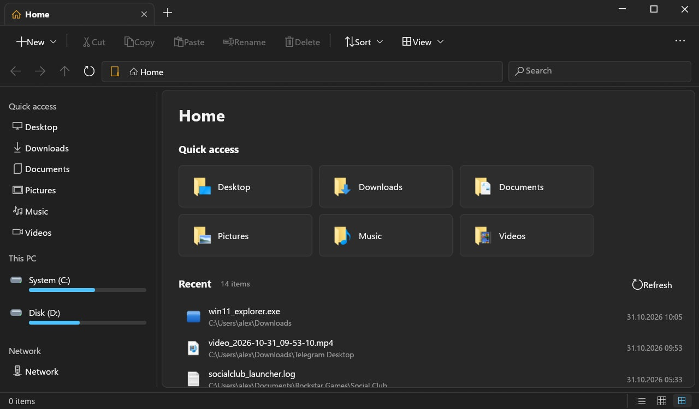
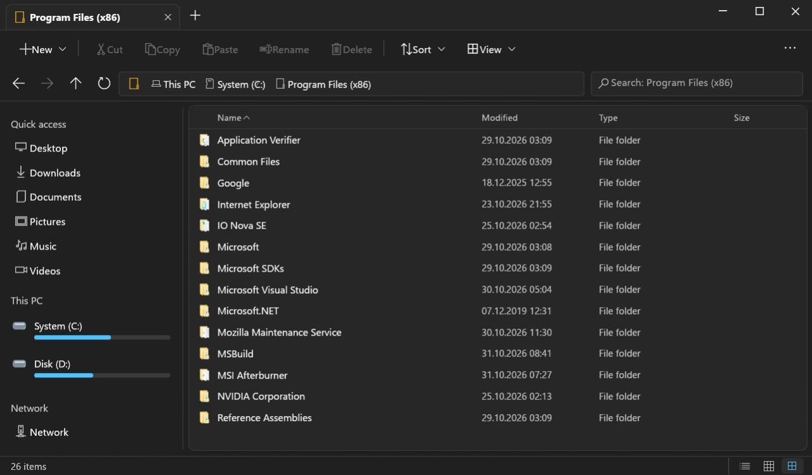
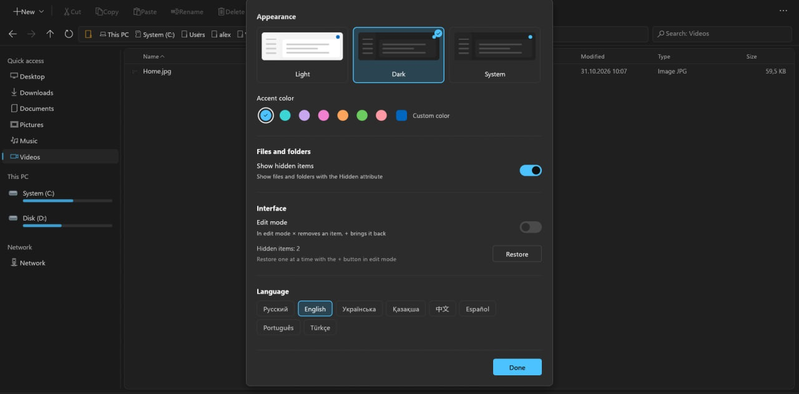
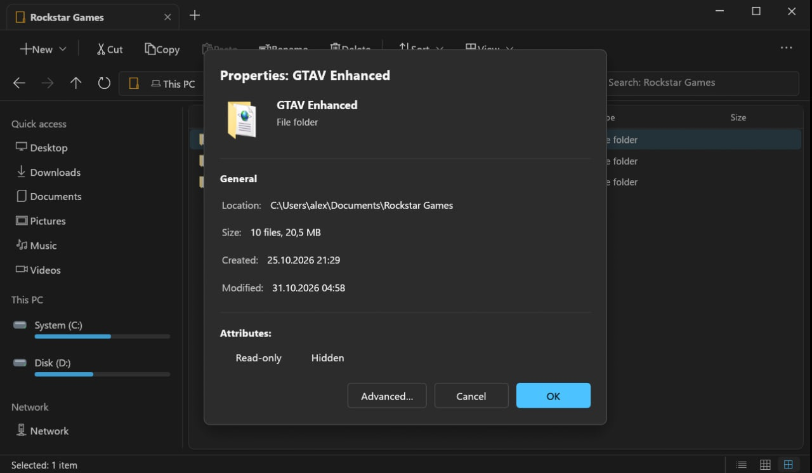

---

## Установка

### Способ 1: Через PowerShell (автоматически)

Откройте PowerShell и выполните следующую команду. Она скачает последний установщик и запустит его:

```powershell
Invoke-WebRequest -Uri "https://github.com/ScrSrc/rust-explorer-eleven/releases/latest/download/win11_explorer-1.0.0-x86_64.msi" -OutFile "$env:TEMP\win11_explorer.msi"
Start-Process msiexec.exe -ArgumentList "/i $env:TEMP\win11_explorer.msi" -Wait
